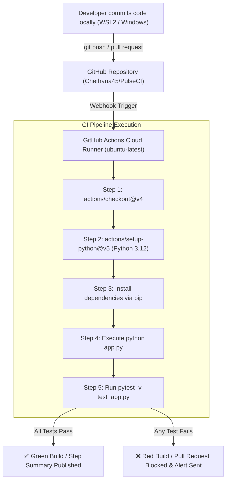

# PulseCI – Automated CI Pipeline

[](https://github.com/Chethana45/PulseCI/actions/workflows/ci.yml)
[](https://www.python.org/)
[](https://docs.pytest.org/)
[](https://opensource.org/licenses/MIT)

A beginner-friendly DevOps Continuous Integration (CI) project that automates dependency management, application verification, and test execution using **GitHub Actions**.

---

## 📌 Table of Contents
- [Project Overview](#-project-overview)
- [Problem Statement](#-problem-statement)
- [Solution](#-solution)
- [Architecture Diagram](#-architecture-diagram)
- [Technology Stack](#-technology-stack)
- [Project Structure](#-project-structure)
- [Local Setup & Installation](#-local-setup--installation)
  - [Prerequisites](#prerequisites)
  - [Option A: WSL2 Ubuntu (Recommended)](#option-a-wsl2-ubuntu-recommended)
  - [Option B: Windows PowerShell](#option-b-windows-powershell)
- [Running the Application Locally](#-running-the-application-locally)
- [Running Automated Tests](#-running-automated-tests)
- [How GitHub Actions Works](#-how-github-actions-works)
- [Pushing to GitHub & Triggering the Pipeline](#-pushing-to-github--triggering-the-pipeline)
- [Screenshots & Verification](#-screenshots--verification)
- [Learning Outcomes](#-learning-outcomes)
- [Future Enhancements](#-future-enhancements)

---

## 📖 Project Overview

**PulseCI** demonstrates the foundational building block of modern DevOps: **Automated Continuous Integration (CI)**.

Whenever a developer pushes new code or opens a Pull Request against the `main` branch, a GitHub Actions runner automatically:
1. Provisions a clean Ubuntu virtual machine.
2. Checks out the repository code.
3. Configures the Python 3.12 runtime environment.
4. Installs required project dependencies from `requirements.txt`.
5. Executes the core application logic to verify runtime stability.
6. Runs a suite of unit, boundary, and error-handling tests using `pytest`.
7. Generates a clear pass/fail status report and step summary.

---

## 🛑 Problem Statement

In traditional software development without CI:
- Developers test code only on their local machines (*"It works on my machine!"* syndrome).
- Broken code, missing dependencies, or failing regression tests are frequently merged into production branches.
- Manual testing before each release is slow, repetitive, and error-prone.
- Teams lack real-time visibility into the health and stability of the codebase.

---

## 💡 Solution

**PulseCI** introduces an automated feedback loop:
- **Instant Feedback:** Every code change pushed to GitHub is validated in seconds.
- **Consistent Testing Environment:** Every build runs in an isolated, standardized runner (`ubuntu-latest`), eliminating environment discrepancies.
- **Quality Gate:** Failing tests immediately block bad code from entering the repository.
- **Zero Manual Effort:** Testing and verification require zero manual intervention from developers.

---

## 🏗️ Architecture Diagram



---

## 🛠️ Technology Stack

| Technology | Purpose |
| :--- | :--- |
| **Python 3.12** | Core programming language for application and tests |
| **Pytest** | Testing framework for unit, boundary, and error validation |
| **Git** | Distributed version control system |
| **GitHub** | Cloud-hosted Git repository and collaboration platform |
| **GitHub Actions** | Cloud-native Continuous Integration (CI) platform |
| **YAML** | Declarative configuration format for CI pipelines |
| **WSL2 (Ubuntu)** | Local Linux development environment on Windows |

---

## 📂 Project Structure

```text
PulseCI/
├── .github/
│   └── workflows/
│       └── ci.yml          # GitHub Actions CI workflow definition
├── app.py                  # Core pricing and discount calculation module
├── test_app.py             # Pytest suite (normal, boundary, and invalid tests)
├── requirements.txt        # Project dependencies (pytest)
├── .gitignore              # Files and folders ignored by Git
└── README.md               # Project documentation and guide
```

### File Breakdown:
- **`app.py`**: Contains core pricing calculations (`calculate_discount`, `calculate_total_price`, and `validate_number`). Includes an executable `main()` demo.
- **`test_app.py`**: Automated test suite containing 9 test cases covering standard inputs, boundary values (0%, 100%, single item), and invalid inputs (negative prices, strings, invalid ranges).
- **`requirements.txt`**: Specifies test dependencies (`pytest>=7.4.0`).
- **`.gitignore`**: Prevents Python cache (`__pycache__`), virtual environments (`.venv`), and test artifacts from polluting Git.
- **`.github/workflows/ci.yml`**: The CI configuration file instructing GitHub Actions what steps to run on every push and PR.

---

## 💻 Local Setup & Installation

Follow these simple steps to run PulseCI on your local machine.

### Prerequisites
Make sure you have either **WSL2 (Ubuntu)** or **Windows with Python 3** installed.

---

### Option A: WSL2 Ubuntu (Recommended)

1. **Open your WSL2 terminal** and navigate to your project directory:
   ```bash
   cd "/mnt/c/Users/cheth/OneDrive/Desktop/PulseCI – Automated CI Pipeline"
   ```

2. **Verify Python & Pip are installed:**
   ```bash
   python3 --version
   pip3 --version
   ```
   *(If not installed: `sudo apt update && sudo apt install -y python3 python3-pip python3-venv`)*

3. **Create and activate a virtual environment:**
   ```bash
   python3 -m venv .venv
   source .venv/bin/activate
   ```

4. **Install project dependencies:**
   ```bash
   pip install --upgrade pip
   pip install -r requirements.txt
   ```

---

### Option B: Windows PowerShell

1. **Open PowerShell** in the project folder:
   ```powershell
   cd "c:\Users\cheth\OneDrive\Desktop\PulseCI – Automated CI Pipeline"
   ```

2. **Create and activate a virtual environment:**
   ```powershell
   python -m venv .venv
   .\.venv\Scripts\Activate.ps1
   ```
   *(If script execution is restricted: `Set-ExecutionPolicy -Scope Process -ExecutionPolicy Bypass`)*

3. **Install project dependencies:**
   ```powershell
   python -m pip install --upgrade pip
   pip install -r requirements.txt
   ```

---

## 🚀 Running the Application Locally

To execute the application and see the pricing engine in action:

**WSL2 Ubuntu:**
```bash
python3 app.py
```

**Windows PowerShell:**
```powershell
python app.py
```

**Expected Output:**
```text
==================================================
 PulseCI E-Commerce Pricing Engine 
==================================================
Item Unit Price    : $49.99
Quantity           : 3
Discount Rate      : 10.0%
Tax Rate           : 8.5%
--------------------------------------------------
Final Total Price  : $146.44
==================================================
[SUCCESS] Application executed cleanly.
```

---

## 🧪 Running Automated Tests

Run the Pytest suite locally to verify all test cases:

```bash
pytest -v
```

**Expected Output:**
```text
============================= test session starts ==============================
collected 9 items

test_app.py::test_calculate_discount_normal PASSED                       [ 11%]
test_app.py::test_calculate_total_price_normal PASSED                    [ 22%]
test_app.py::test_calculate_discount_zero_percent PASSED                 [ 33%]
test_app.py::test_calculate_discount_full_hundred_percent PASSED         [ 44%]
test_app.py::test_calculate_total_price_minimum_quantity_and_zero_tax PASSED [ 55%]
test_app.py::test_calculate_discount_exceeding_max_percentage PASSED     [ 66%]
test_app.py::test_calculate_total_price_negative_unit_price PASSED       [ 77%]
test_app.py::test_calculate_total_price_zero_quantity PASSED             [ 88%]
test_app.py::test_validate_number_non_numeric_type PASSED                [100%]

============================== 9 passed in 0.19s ===============================
```

### Test Case Overview:
1. `test_calculate_discount_normal`: Normal 20% discount calculation.
2. `test_calculate_total_price_normal`: Full pricing flow with discount and sales tax.
3. `test_calculate_discount_zero_percent`: Boundary test verifying 0% discount equals $0.
4. `test_calculate_discount_full_hundred_percent`: Boundary test verifying 100% discount covers full cost.
5. `test_calculate_total_price_minimum_quantity_and_zero_tax`: Boundary test with quantity 1 and zero tax.
6. `test_calculate_discount_exceeding_max_percentage`: Error test asserting rejection of > 100% discount.
7. `test_calculate_total_price_negative_unit_price`: Error test asserting rejection of negative prices.
8. `test_calculate_total_price_zero_quantity`: Error test asserting quantity cannot be 0.
9. `test_validate_number_non_numeric_type`: Error test asserting rejection of non-numeric data types.

---

## ⚙️ How GitHub Actions Works

The automated pipeline is defined in `.github/workflows/ci.yml`. Here is how each component works:

1. **Triggers (`'on':`):**
   - Listens for `push` events to `main`.
   - Listens for `pull_request` events targeting `main`.
2. **Runner (`runs-on: ubuntu-latest`):**
   - GitHub provisions a fresh, secure Ubuntu Linux virtual environment in the cloud.
3. **Checkout (`actions/checkout@v4`):**
   - Clones your repository into the runner's workspace.
4. **Python Setup (`actions/setup-python@v5`):**
   - Installs Python 3.12 and enables pip dependency caching.
5. **Dependency Installation (`pip install`):**
   - Upgrades pip and installs all packages listed in `requirements.txt`.
6. **Application Execution:**
   - Runs `python app.py` to ensure the program executes cleanly without runtime crashes.
7. **Pytest Suite:**
   - Runs `pytest -v` to validate all business rules and edge cases.
8. **Job Status & Summary:**
   - If all steps exit with code `0`, GitHub marks the workflow with a green checkmark (`✔`) and writes a success summary.
   - If any step fails (exit code != 0), the workflow turns red (`✖`), writes a failure notice, and halts further progress.

---

## 📤 Pushing to GitHub & Triggering the Pipeline

Follow these steps to publish your project and trigger your pipeline:

### 1. Initialize Git and Commit
```bash
git init
git branch -M main
git add .
git commit -m "Build PulseCI automated CI pipeline"
```

### 2. Configure Remote URL
```bash
git remote add origin https://github.com/Chethana45/PulseCI.git
```

### 3. Push to GitHub
```bash
git push -u origin main
```

---

## 📸 Screenshots & Verification

> Once your workflow completes on GitHub, you can add screenshots of your run to this section.

| Workflow Run Overview | Pytest Execution in GitHub Actions |
| :---: | :---: |
| *GitHub Actions workflow list with green checkmark (✔)* | *Expanded Pytest step log showing all 9 passed tests* |

---

## 🧠 Learning Outcomes

By building and running **PulseCI**, you have mastered several core DevOps principles:
1. **Continuous Integration (CI):** Understand how automated pipelines replace manual testing and prevent broken code from merging.
2. **Automated Quality Gates:** Implement unit tests, boundary validations, and error assertions that automatically approve or reject pull requests.
3. **Infrastructure as Code (IaC) & Workflow as Code:** Write declarative YAML pipelines to provision environments on demand in GitHub's cloud.
4. **Environment Parity:** Replicate consistent results across Windows, WSL2 Ubuntu, and cloud Linux runners.
5. **Git Hygiene:** Use `.gitignore` to maintain clean repository trees free of compiled bytecode and local virtual environments.

---

## 🔮 Future Enhancements

As you continue your DevOps journey, here are recommended additions to expand PulseCI:
- [ ] **Code Linting & Formatting:** Add `ruff` or `flake8` to enforce PEP 8 style standards automatically in CI.
- [ ] **Test Coverage Reports:** Integrate `pytest-cov` and upload coverage badges to [Codecov](https://codecov.io/).
- [ ] **Multi-Version Matrix Builds:** Test concurrently against Python `3.10`, `3.11`, `3.12`, and `3.13`.
- [ ] **Security Scanning:** Integrate `bandit` to identify security vulnerabilities in Python code.
- [ ] **ChatOps Notifications:** Send a Discord or Slack notification when a pipeline fails.

---

## 📄 License
This project is open-source under the [MIT License](LICENSE).
