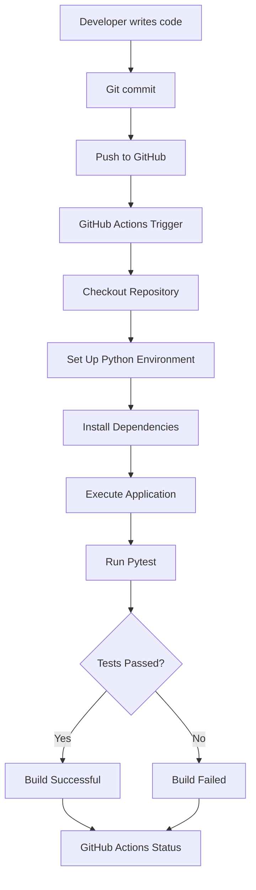

# ⚡ PulseCI — Automated CI Pipeline

<p align="center">
  <b>Every push. Automatically tested. Always reliable.</b>
</p>

<p align="center">
  
  
  
  
  
</p>

## 🚀 Overview

**PulseCI** is a beginner-friendly Continuous Integration (CI) project that demonstrates how software testing can be automated using GitHub Actions.

Traditionally, developers need to remember to run tests manually every time they modify their code. This can lead to overlooked bugs, inconsistent testing, and unreliable code changes.

PulseCI addresses this problem by introducing an automated pipeline that executes whenever code is pushed to GitHub or a pull request is created.

Instead of depending entirely on manual testing, every code change goes through an automated validation process before it is considered ready.

## 🎯 Problem Statement

Manual testing after every code modification is repetitive, time-consuming, and easy to forget. A developer might accidentally push code containing bugs without realizing it.

**The solution:** Automate the testing process through GitHub Actions so that every code change is automatically checked.

## 💡 How PulseCI Works

1. A developer modifies the Python application.
2. The changes are pushed to the GitHub repository.
3. GitHub Actions automatically triggers the CI workflow.
4. The workflow checks out the repository.
5. Python and required dependencies are installed.
6. The application is executed.
7. Pytest runs automated test cases.
8. GitHub reports whether the workflow succeeded or failed.

## 🏗️ System Architecture



## 🛠️ Tech Stack

| Technology | Purpose |
|---|---|
| Python | Application development |
| Pytest | Automated testing |
| Git | Version control |
| GitHub | Source code hosting |
| GitHub Actions | CI workflow automation |
| YAML | Workflow configuration |

## 📂 Project Structure

```text
PulseCI/
│
├── .github/
│   └── workflows/
│       └── ci.yml
│
├── app.py
├── test_app.py
├── requirements.txt
├── .gitignore
└── README.md
```

| File | Description |
|---|---|
| `app.py` | Contains the Python application logic |
| `test_app.py` | Contains automated test cases |
| `requirements.txt` | Lists project dependencies |
| `ci.yml` | Defines the GitHub Actions workflow |
| `.gitignore` | Excludes unnecessary files |

## ⚙️ Getting Started

### 1. Clone the repository

```bash
git clone https://github.com/Chethana45/PulseCI.git
cd PulseCI
```

### 2. Create a virtual environment

```bash
python -m venv venv
```

Activate it on Windows:

```powershell
venv\Scripts\activate
```

For WSL Ubuntu:

```bash
source venv/bin/activate
```

### 3. Install dependencies

```bash
pip install -r requirements.txt
```

### 4. Run the application

```bash
python app.py
```

### 5. Run automated tests

```bash
pytest -v
```

## 🔄 GitHub Actions Workflow

The CI pipeline is configured inside:

`.github/workflows/ci.yml`

It automatically runs on:

- Push events to the `main` branch.
- Pull requests targeting the `main` branch.

The workflow performs:

- Repository checkout.
- Python environment setup.
- Dependency installation.
- Application execution.
- Automated test execution.

### Pipeline Result

<details>
<summary>✅ Successful workflow</summary>

When all test cases pass, GitHub Actions marks the workflow as successful with a green checkmark.

</details>

<details>
<summary>❌ Failed workflow</summary>

When a test fails or a workflow step encounters an error, GitHub Actions marks the workflow as failed. The developer can inspect the logs, fix the issue, and push the changes again.

</details>


## 📚 Key DevOps Concepts Learned

- Understanding Continuous Integration.
- Automating software testing.
- Configuring YAML-based workflows.
- Using GitHub Actions runners.
- Managing Python dependencies.
- Understanding push and pull request triggers.
- Identifying successful and failed pipeline executions.

## 🔮 Future Enhancements

- Add Docker-based application builds.
- Introduce code quality checks using Flake8.
- Add code coverage reports.
- Integrate Continuous Deployment.
- Deploy the application to a cloud platform.
- Add status badges reflecting the actual workflow result.

## 👩‍💻 Author

**Chethana Sri**

BE Computer Science Engineering  
Madras Institute of Technology, Anna University

- GitHub: [@Chethana45](https://github.com/Chethana45)
- Project: [PulseCI](https://github.com/Chethana45/PulseCI)

---

<p align="center">
  <b>PulseCI — Making every code push count.</b>
</p>
